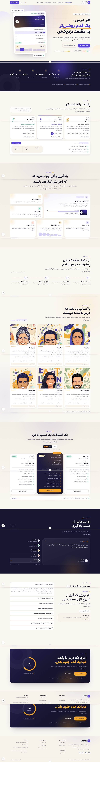
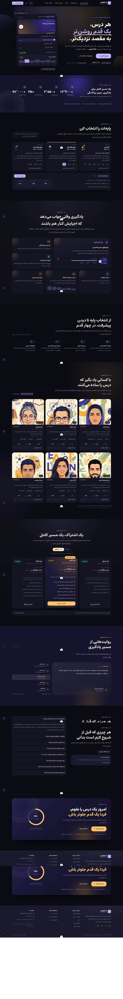
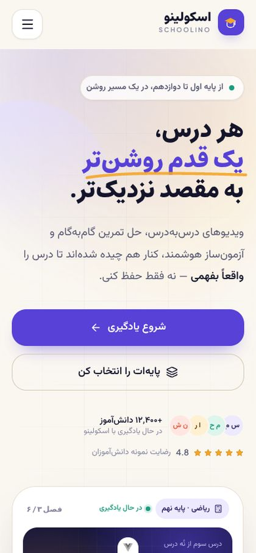

# اسکولینو · Schoolino

> **بهتر یاد بگیر، جلوتر برو.**
> A premium, Persian-first (RTL) landing page for an online school — built with Vue 3, TypeScript,
> Vuetify, Tailwind CSS, Bun and Vite.

Schoolino is a frontend-only demonstration of a learning platform for grades 1–12: video lessons
chapter by chapter, step-by-step exercise walkthroughs and a smart exam builder. The deliverable is a
single, fully responsive landing page with an original design system, a purposeful motion system and
honest demo interactions (no fake backend).



---

## Highlights

- **Original identity** — warm cream canvas, indigo brand, saffron accent; custom logo, geometric
  level glyphs and an illustration set made for this project (no stock photos, no copied branding).
- **Persian-first typography** — Estedad (display), Vazirmatn (body), Plus Jakarta Sans (Latin),
  self-hosted, Persian numerals via `Intl.NumberFormat('fa-IR')`.
- **Complete landing page** — header, hero (with an interactive lesson mock), stats, grades selector,
  value proposition bento, learning path, teachers, pricing with a billing toggle, testimonials
  carousel, FAQ accordion, closing CTA and footer.
- **Accessible by construction** — WCAG 2.2 AA patterns: skip link, landmarks, visible focus rings,
  `aria-current`/`aria-pressed`/`aria-expanded`, live regions, 44px+ touch targets, scroll padding for
  the sticky header, and three layers of `prefers-reduced-motion` support.
- **Light + dark themes** — token-driven, persisted, applied before first paint (no flash).
- **Honest demo** — every action that would need a backend shows a clear, dismissible notice.
- **Engineered** — strict TypeScript, typed content separated from presentation, zod-validated data,
  64 Vitest tests, ESLint + Prettier, production build within budget.

| Dark theme                                           | Mobile                                                                       |
| ---------------------------------------------------- | ---------------------------------------------------------------------------- |
|  |  |

---

## Tech stack

| Area                      | Choice                                                   |
| ------------------------- | -------------------------------------------------------- |
| Framework                 | Vue 3.5 (`<script setup lang="ts">`)                     |
| Language                  | TypeScript 5.9 (strict, `noUncheckedIndexedAccess`)      |
| Package manager / runtime | Bun 1.4                                                  |
| Build & dev server        | Vite 7 + `@vitejs/plugin-vue`                            |
| UI behaviour              | Vuetify 3.13 (drawer, expansion panels, theme)           |
| Styling                   | Tailwind CSS 4 (CSS-first tokens) + design-system layers |
| Animation                 | CSS transitions, `@vueuse/motion`, IntersectionObserver  |
| Utilities                 | VueUse 13                                                |
| Icons                     | Iconify + a generated Lucide subset (offline, 16 KB)     |
| Validation                | Zod 3                                                    |
| Tests                     | Vitest 3 + `@vue/test-utils` (jsdom)                     |
| Quality                   | ESLint 9 (flat) + Prettier 3 + `vue-tsc`                 |

Rationale, alternatives and rejected options: [`docs/TECH_STACK.md`](docs/TECH_STACK.md),
[`docs/DECISIONS.md`](docs/DECISIONS.md).

---

## Getting started

Requirements: **Bun ≥ 1.1** (or npm 10+) and **Node ≥ 20.19** for the tooling.

```bash
# 1. install dependencies
bun install

# 2. start the dev server (http://localhost:5173)
bun run dev
```

Other scripts:

```bash
bun run build          # type-check + production build (dist/)
bun run preview        # serve the production build (http://localhost:4173)
bun run typecheck      # vue-tsc --noEmit style check
bun run test           # Vitest, single run
bun run test:watch     # Vitest, watch mode
bun run test:coverage  # coverage for utils/composables/data
bun run lint           # ESLint
bun run format         # Prettier write
bun run format:check   # Prettier check
```

npm equivalents work too: `npm install`, `npm run dev`, `npm run build`, `npm test`.

The dev server binds to `0.0.0.0:5173` with `allowedHosts: true` so it can be opened through a
sandbox/preview domain as well as locally.

---

## Project structure

```
src/
├─ components/
│  ├─ layout/     SiteHeader, SiteFooter, ThemeToggle, BackToTop, DemoNoticeHost
│  ├─ sections/   Hero, Stats, Grades, Why, Steps, Teachers, Plans, Testimonials, Faq, FinalCta
│  └─ ui/         AppIcon, BrandLogo, SectionHeading, StarRating, AvatarStack, StatCounter,
│                 LevelGlyph, BillingToggle
├─ composables/   useTheme, useScrollSpy, useCountUp, useCarousel, useBilling, useDemoNotice,
│                 useEntrance
├─ data/          Typed content: levels, features, teachers, stats, plans, testimonials, faqs,
│                 steps, navigation, site + zod schemas
├─ plugins/       vuetify, icons (offline subset), reveal (v-reveal directive)
├─ styles/        main.css (tokens + layers), vuetify-settings.scss
├─ types/         content model
├─ utils/         format (Persian numbers/prices), scroll
├─ App.vue  main.ts  env.d.ts
tests/            setup, mount helper, unit specs
docs/             Phase 0 documentation, QA report, screenshots
scripts/          build-icon-subset.mjs
```

Details: [`docs/ARCHITECTURE.md`](docs/ARCHITECTURE.md).

---

## Documentation

| Document                                                       | Contents                                                  |
| -------------------------------------------------------------- | --------------------------------------------------------- |
| [`docs/PROJECT_OVERVIEW.md`](docs/PROJECT_OVERVIEW.md)         | Vision, scope, personas, positioning                      |
| [`docs/RESEARCH.md`](docs/RESEARCH.md)                         | Reference-site research and how it shaped the design      |
| [`docs/PRODUCT_REQUIREMENTS.md`](docs/PRODUCT_REQUIREMENTS.md) | Functional & non-functional requirements                  |
| [`docs/DESIGN_SYSTEM.md`](docs/DESIGN_SYSTEM.md)               | Colour, type, spacing, components, tokens, contrast audit |
| [`docs/ANIMATION_GUIDELINES.md`](docs/ANIMATION_GUIDELINES.md) | Motion tokens, hierarchy, implementation, reduced motion  |
| [`docs/ARCHITECTURE.md`](docs/ARCHITECTURE.md)                 | Folder structure, layering rules, API readiness, testing  |
| [`docs/TECH_STACK.md`](docs/TECH_STACK.md)                     | Dependencies, versions, why each one exists               |
| [`docs/ROADMAP.md`](docs/ROADMAP.md)                           | Milestones delivered + future phases                      |
| [`docs/TASKS.md`](docs/TASKS.md)                               | Task list with acceptance criteria and status             |
| [`docs/QUALITY_STANDARDS.md`](docs/QUALITY_STANDARDS.md)       | Code, accessibility, performance, testing rules           |
| [`docs/DECISIONS.md`](docs/DECISIONS.md)                       | Decision log with alternatives                            |
| [`docs/QA_REPORT.md`](docs/QA_REPORT.md)                       | Verification results, known limitations                   |

---

## Honest demo notes

- No authentication, payments, video streaming or backend calls exist.
- Prices, statistics, testimonials, teacher profiles and contact details are **sample content** and are
  labelled as such in the UI.
- Every CTA that would need a server (sign-up, checkout, social links, teacher profiles, support)
  opens a short, dismissible notice explaining what is missing — nothing silently fails and nothing
  pretends to succeed.

## Browser support

Evergreen Chrome, Edge, Firefox and Safari. Output targets ES2022; the page degrades to readable
static content without JavaScript.
